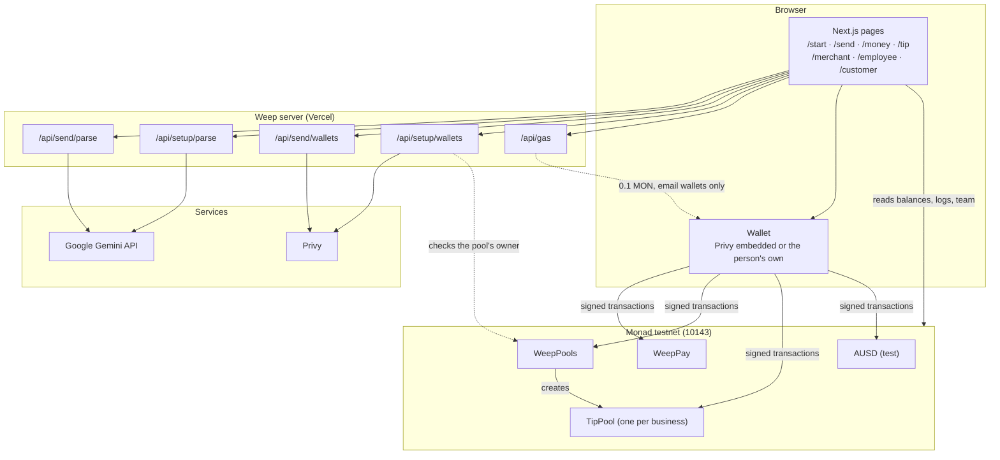
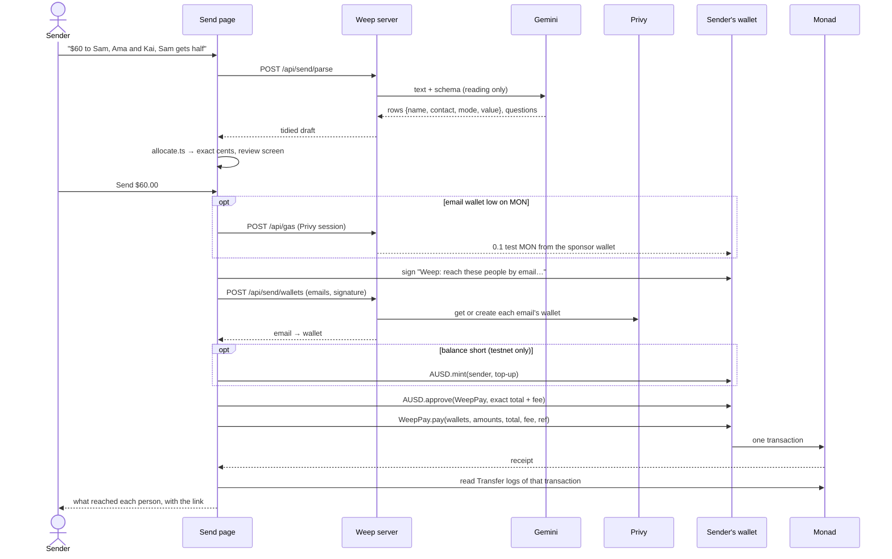

# Architecture

How Weep is built: the parts, how money and data move through them, who controls what, and what happens when something fails. It describes the deployed system on Monad testnet as of 8 October 2026.

For what each route accepts and returns, see [api.md](api.md). For the plain-language version, see [How money moves](https://weep-protocol.vercel.app/how-money-moves).

## System at a glance



**The browser** renders every screen, works out amounts, and reads Monad directly through the public RPC. Every transaction is signed in the person's own wallet.

**The server** handles the few tasks that need a secret: it holds the Gemini key, the Privy app secret and the sponsor wallet that covers first fees. It is serverless and keeps zero data about users or payments.

**Monad** holds all the state: balances, payments, each business's team and split.

## Components

| Part | Responsibility | Source |
|---|---|---|
| Role chooser | Individual · Business switch (remembered) and three cards per side | [`Hero.tsx`](../frontend/src/app/Hero.tsx), [`roles.ts`](../frontend/src/app/roles.ts) |
| Send | Words → draft rows → exact review → one WeepPay payment → receipt from logs | [`send/SendFlow.tsx`](../frontend/src/app/send/SendFlow.tsx) |
| Amount rules | Fixed, percentage, equal; leftover cents to the first rows | [`allocate.ts`](../frontend/src/app/allocate.ts) |
| My money / Employee Dashboard | Balance and payments in, with sender and time | [`received.ts`](../frontend/src/app/received.ts), [`money/`](../frontend/src/app/money), [`employee/`](../frontend/src/app/employee) |
| Tip / Customer | Opens a code or link; tips a person or the team | [`tip/`](../frontend/src/app/tip), [`customer/TipFlow.tsx`](../frontend/src/app/customer/TipFlow.tsx) |
| Merchant Portal | One-prompt team setup, live pool, payout | [`merchant/TeamSetup.tsx`](../frontend/src/app/merchant/TeamSetup.tsx) |
| Chain access | RPC, explorer, call data, receipts (`transfersIn`), recent arrivals (`receivedRecently`) | [`chain.ts`](../frontend/src/app/chain.ts), [`pay.ts`](../frontend/src/app/pay.ts) |
| Reading descriptions | One shared Gemini helper: structured JSON, model fallback, one retry, 20-second timeout | [`api/gemini.ts`](../frontend/src/app/api/gemini.ts) |
| Sign-in | Weep's own window: email code, a passkey (create one, or sign back in), or a wallet; Privy underneath. Email and passkey accounts get a Privy wallet | [`ConnectModal.tsx`](../frontend/src/app/ConnectModal.tsx), [`providers.tsx`](../frontend/src/app/providers.tsx) |
| WeepPay | `pay(to[], amounts[], total, expectedFee, ref)`: exact, all at once, ≤ 100 recipients, 0.3% fee on top (fixed at deployment), ownerless | [`WeepPay.sol`](../contracts/contracts/WeepPay.sol) |
| WeepPools | Gives every business its own pool: `create(split, team)` clones TipPool, one per owner, at an address known in advance (`predict`). Holds the token, fee rate (0.5%) and fee recipient every pool copies. Ownerless | [`WeepPools.sol`](../contracts/contracts/WeepPools.sol) |
| TipPool | One business's pool: `tipIndividual(name, expectedWallet, amount, expectedFee)`, `tipTeam(amount, expectedFee)`, `payoutTeam()` (anyone), `configure` (owner: split and team in one call). Team capped at 100; token-moving functions guarded against re-entry | [`TipPool.sol`](../contracts/contracts/TipPool.sol) |
| Business links | Table codes and links carry the business's pool (`/customer?pool=0x…`); checked against WeepPools before use and remembered on the device | [`pool-link.ts`](../frontend/src/app/pool-link.ts) |
| First-fee cover | An email wallet that's low on MON gets 0.1 test MON from Weep's sponsor wallet before its first transaction | [`gas.ts`](../frontend/src/app/gas.ts), [`api/gas`](../frontend/src/app/api/gas/route.ts) |

## Flows

### Send: one payment to many people



`ref` is `keccak256` of the recipient:amount pairs. It ties the payment to what was reviewed while keeping names and emails off Monad.

### Business: set up, tip, pay out

1. **Set up** (Merchant Portal). Any business can do this; each gets its own pool.
   1. `/api/setup/parse` reads the team description: names, emails, groups and split.
   2. The business reviews it. If Weep's Chainlink CRE workflow has attested this exact description for this pool, and the review still matches, the card says *Read by Chainlink CRE · attested on Monad* (see [Chainlink CRE](#chainlink-cre)).
   3. `/api/setup/wallets` creates wallets for every email. The request names the pool and is signed by its owner, or, before it exists, by the wallet whose pool `WeepPools.predict` puts at that address. The server checks both on Monad.
   4. One confirmation: `WeepPools.create(split, names, wallets, groups)` the first time, or `TipPool.configure(...)` to change it later.
   5. The live screen shows the table code: `/customer?pool=<the business's pool>`.
2. **Tip a person** (Customer, opened from that code). The page checks with WeepPools that the pool is real and reads its fee. The guest sees the 0.5% fee, approves exactly the tip plus the fee, and `tipIndividual(name, wallet, amount, fee)` moves the tip straight to that person and the fee to Weep. The tip always goes to the wallet the guest saw, with the fee they reviewed.
3. **Tip the team** (Customer). The guest approves the tip plus the fee, and `tipTeam(amount, fee)` moves the tip into the business's pool and the fee to Weep.
4. **Pay out** (Merchant Portal, or anyone from the table code's *Split details*). Anyone can call `payoutTeam()`; it always pays the saved team.
   - The pool is split by policy among groups that have people.
   - Each group's share is split evenly within the group.
   - Any remainder from integer division (well under a cent) stays for the next payout.

### Receiving

My money and the Employee Dashboard poll every 4 seconds while the tab is visible. Each poll reads the wallet's AUSD balance and the `Transfer` events into it over the last ~100 blocks, which is the public RPC's log window. Block timestamps give each payment's time. Payments seen are remembered on the device, so the list survives reloads. If the sender is a Weep pool (checked with WeepPools), the payment is labelled "team tips". A tab that comes back into view reads at once instead of waiting for the next poll.

## Amount rules

The rules live in [`allocate.ts`](../frontend/src/app/allocate.ts):

1. Fixed amounts are taken first.
2. Percentages of the total come next, rounded down to the cent.
3. The remainder is divided equally among rows marked equal.
4. Leftover cents go one each to the first rows, and the review marks them with +1¢.

If fixed and percentage amounts go over the total, the review highlights it so the sender can adjust before sending. WeepPay checks the sum again on-chain.

### Chainlink CRE

The [`cre/weep-policy`](../cre) workflow reads a team description through Chainlink's network and records the result on Monad.

1. An HTTP trigger receives `{ pool, description }`.
2. Through the HTTP capability, Gemini reads the team and split at temperature 0, against a fixed schema. The response is cached across nodes, so they reach identical-answer consensus.
3. `policy.ts` checks the answer by the pool's rules: the split adds up to 100, 1–100 people, unique names, and plain first names only.
4. The workflow encodes `(pool, keccak256(description), foh, boh, bar, names, groups)` as a report the DON signs. `writeReport` delivers it through the Chainlink Forwarder to `WeepPolicyRegistry.onReport`.
5. The registry checks the same rules again, stores the latest policy for that pool and emits `PolicyAttested`.
6. The Merchant Portal reads `policyOf(pool)`. It shows the line only when the description's hash matches the text the business typed and the reviewed team and split are identical.

The registry is a public record of each team setup; the business saves its team with its own `create` or `configure`.

## Who does what

| Actor | Role |
|---|---|
| Sender | Pays anyone, up to the amount their own wallet allowed |
| WeepPay | Moves a sender's AUSD within the allowance they gave, in the payment they signed. Ownerless, fixed and open to read |
| A business (pool owner) | Sets its own pool's team and split, and updates them once waiting team tips are paid out |
| Anyone | Pays a pool out, always to the saved team by the saved split |
| Weep (fee recipient) | Receives the fee set at deployment |
| WeepPools | Creates one pool per business, owned by that business. Ownerless |
| Weep server | Asks Privy for wallets for emails a signer named; reads text with Gemini; sends 0.1 test MON to a signed-in person's own email wallet when it's low. Every transaction is signed by the person in their own wallet |
| Privy | Creates and links non-custodial wallets to emails, and runs sign-in. Each person holds their own wallet |
| Chainlink Forwarder | Writes a DON-signed policy record to WeepPolicyRegistry, checked by the pool's rules |
| Gemini | Drafts rows from text. Weep's code does the maths, and the person approves |

Protections on the server routes:

- Email lookups carry a fresh signature (under 10 minutes old) over the exact sorted emails, up to 100 emails per request.
- Team wallets carry the pool owner's signature (or, for a new pool, the signature of the wallet whose pool will be created there), up to 50 emails.
- Descriptions are up to 6,000 characters for Send and 4,000 for the Merchant Portal.
- First-fee cover checks a valid Privy session for the wallet's owner, serves Privy email wallets holding under 0.05 MON with fewer than 20 transactions, and keeps at least 1 MON in the sponsor wallet.

## Every case handled

| Situation | What the person sees | Their money |
|---|---|---|
| Gemini busy | Each model gets one retry after a short pause, then the next model takes over, with an option to add people by hand | Stays with them |
| Running locally before adding server keys | Send lets you add people yourself, and email payments show how to switch them on | Stays with them |
| Email lookup slow | A message inviting them to try again | Stays with them |
| MON needed for fees | Email wallets: Weep covers it ("Covering the network fee"). Other wallets: the faucet opens, with a note | Stays with them until the fee is ready |
| A table code from elsewhere | A message that this code is for a different pool | Stays with them |
| A different network | "Switch to Monad at the top, then send." | Stays with them |
| Wallet prompt cancelled | A note that the payment was cancelled | Stays with them |
| A recipient or total that needs fixing | The contract keeps the whole payment with the sender, and the app explains | Stays with them, all at once |
| A slow confirmation | A pending state that checks again for the same payment | Exactly one payment |

## Data

Weep's server keeps zero data. Privy holds sign-in emails and their wallets. Monad holds payments and business teams (first names, wallets, groups). The browser keeps a few conveniences in local storage. The full inventory, purposes and retention are in the [Privacy notice](https://weep-protocol.vercel.app/privacy).

## Decisions

| Decision | Why |
|---|---|
| A separate WeepPay contract for individuals | Paying people stays simple: one short, ownerless function anyone can read |
| The AI drafts, code calculates | Deterministic rules make every cent reproducible, and the AI focuses on reading |
| Emails resolved to Privy wallets at send time | Anyone with an email can be paid, ready the moment they sign in, in their own non-custodial wallet |
| One signature authorizes an email lookup | Keeps lookups to real senders, with a single wallet prompt |
| Receipts read from `Transfer` logs | The receipt shows exactly what happened on-chain |
| A serverless design | Monad is the record, so there's zero user data to store or sync |
| Exact-total approval | Each payment is limited to the reviewed total plus fee |
| Fee on top, fixed at deployment | Recipients and staff always get 100% of the stated amount, and the fee stays fixed for good |
| Named tips carry the wallet the guest saw | Every tip reaches the person the guest chose |
| Anyone can pay a pool out | Staff get paid on their own schedule, always to the saved team |
| Two roles: owner and anyone | A smaller, simpler design |
| A pool per business from a factory, as minimal clones | Every business owns its pool outright; a clone costs about 0.05 MON to create instead of about 0.36 MON for a full contract; a predictable address lets the team's wallets be approved first |
| Cover the first fee for email sign-ins | A first payment takes just an email |

## Repository map

```text
contracts/            Solidity contracts, Hardhat tests, deploy scripts
  contracts/          WeepPay.sol · WeepPools.sol · TipPool.sol · WeepPolicyRegistry.sol · MockAUSD.sol · mocks/ReentrantToken.sol (tests only)
  scripts/            deploy-all.js · deploy-policy-registry.js · retire-shared-pool.js · live-loop.js · benchmark.js
  test/               WeepPay.test.js · WeepPools.test.js · WeepPolicyRegistry.test.js
cre/                  Chainlink CRE project: weep-policy workflow (TypeScript), CLI settings
frontend/             Next.js app (App Router)
  src/app/            pages, components, chain and amount logic
  src/app/api/        send/{parse,wallets} · setup/{parse,wallets} · gas
docs/                 architecture.md · api.md
```

Earlier experiments are listed in the README's [Good to know](../README.md#good-to-know).
